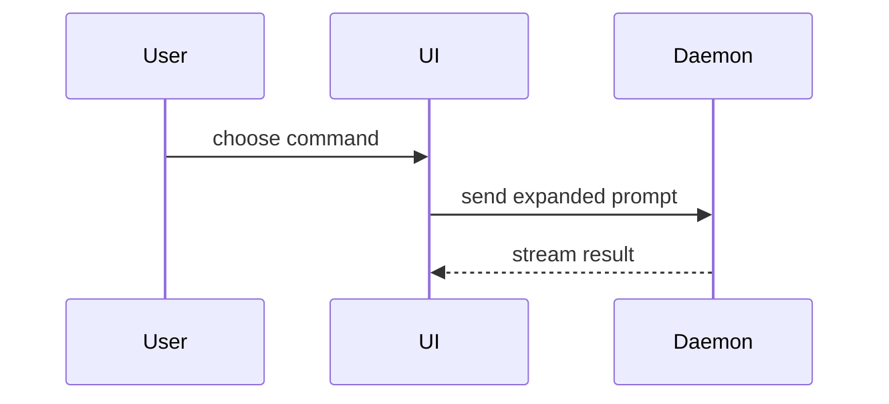

Use this template for writing the PR body:

```markdown
## Summary

<diagram, diff-sketch, or tree>

## Evidence

- **Before:** <screenshot/output/failing test run>
  **After:** <screenshot/output/passing test run>

## Merge Danger

**Door:** <one-way or two-way>

<optional: description>

**Blast Radius:** <one-word description>

<optional: potential ramifications of merge>
```

## Sections

Skip all preambles and keep prose brief. Use the domain language from the repo's glossary, if it has one (for example `GLOSSARY.md` or `docs/terms.md`).

### Summary

Pick the smallest view that makes the key point clear.

- Show logic or an algorithm as pseudocode:

```text
on(save)
  if content is unchanged
    return cached result
  write new content
  return fresh result
```

- Show runtime control flow as a call tree:

```text
submitForm
  createSession
    persistPrompt
    launchAgent
  navigateToSession
```

- Show UI structure as a component tree, including state and module boundaries that matter:

```text
<SessionPage> (apps/example/src/routes/session.tsx)
  useSessionEvents()
  <SessionToolbar>
    <RunSkillButton> (packages/ui)
```

- Show file responsibility or a broad refactor as a shallow file tree:

```text
src/
├── commands/       # parses user actions
├── sessions/       # owns session state
└── transport/      # sends API requests
```

- Show component interaction, control flow, or data flow with Mermaid:



- Use `diff` when the point is what changes and the surrounding shape already exists. Match the diff shape to the topic.

For a component change:

```diff
 <SessionPage>
   useSessionEvents()
   <SessionToolbar>
+    <RunSkillButton />
   <SessionTimeline>
+    <SkillResultCard />
```

For a file-layout change:

```diff
 src/
 ├── commands/
+│   └── show-me.ts       # expands the slash command
 ├── sessions/
-└── transport.ts
+└── transport/
+    ├── client.ts
+    └── stream.ts
```

For a call-tree or call-stack change:

```diff
 submitForm
   createSession
     persistPrompt
+    expandSkillMention
     launchAgent
-  navigateToSession
+  navigateToSession
+    subscribeToEvents
```

For a state or control-flow change:

```diff
 on(save)
-  write content
+  if content is unchanged
+    return cached result
+  write new content
+  invalidate cache
```

- Show the whole block when most of it is new, when omitted context would hide ownership or order, or when the user needs a copyable target shape:

```ts
function expandSkill(command: string): string {
  const skillName = command.slice(1);
  return `use the ${skillName} skill`;
}
```

#### Guidance

Place each visual next to the short text it supports. Keep only the calls, files, props, states, and boundaries needed to answer the user's current question or the options to resolve the current discussion point.

You may use one of these, you may use several, it is unlikely you will use all of them. Use your judgement and don't overwhelm the user.

### Evidence

Concrete evidence that the change works. Show a before and after.

Screenshots are S-tier - when the environment is set up for it and the change is visual.

Execution-based evidence is A-tier. Test results, console output. Show the exact test that now fails and passes, using pseudocode.

#### Attaching screenshots and videos

`gh` uploads images and videos (`gh` 2.99.0 and later), so they do not need to be committed to the branch, left as local paths, or attached by hand in the browser.

Reference the local files where they belong in the body, then pass each one to `--attach`:

```markdown
**Before:** 
**After:** 
```

```sh
gh pr create --title "<title>" --body-file pr-body.md \
  --attach ./shots/before.png --attach ./shots/after.png
```

`gh` uploads the files and rewrites each reference to the hosted URL. A file the body does not reference is appended at the end.

- **Alt text:** `--attach './shots/before.png#Login form before the fix'`. Without it the file name is used.
- **File types:** `png`, `jpg`, `jpeg`, `gif`, `webp`, `svg` up to 10 MB; `mp4`, `mov`, `webm` up to 100 MB. Up to 50 files per command. Anything else (logs, archives, PDFs) goes in a fenced block or a release asset.
- **Video:** put `` alone on its line to get a player. Video takes no alt text.
- **Paths:** relative to the working directory, or to the directory of `--body-file` when the body comes from a file.
- **Other commands:** the same flag works on `gh pr edit`, `gh pr comment`, `gh issue create`, `gh issue edit`, and `gh issue comment`. Without a body flag, `gh pr edit --attach` appends to the body that is already there.
- **Older `gh`:** check with `gh pr create --help | grep -- --attach`. If the flag is missing, leave the image references out of the body and tell the user which files to attach in the browser.

### Merge Danger

Describe whether it's a one-way or two-way door. You can walk back through two-way doors, but not one-way doors. A PR that is cheap to roll back is lower risk. Changes that involve destructive actions or hard-to-reverse decisions are one-way doors.

The blast radius is the potential impact or scope of the changes introduced by this PR. Consider all possibilities. Examples are layout shift, breakages for consumers, mobile responsiveness, etc.
